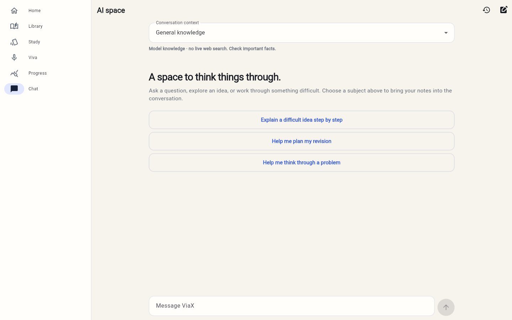
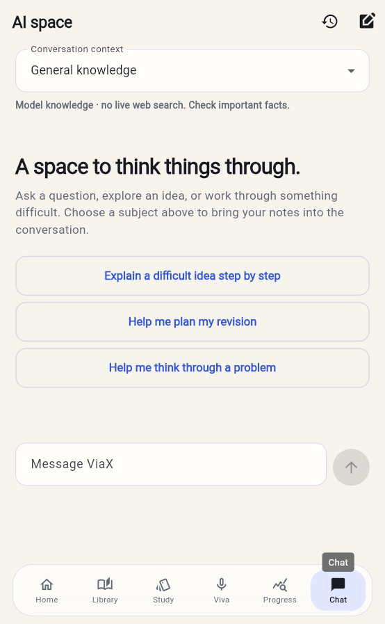
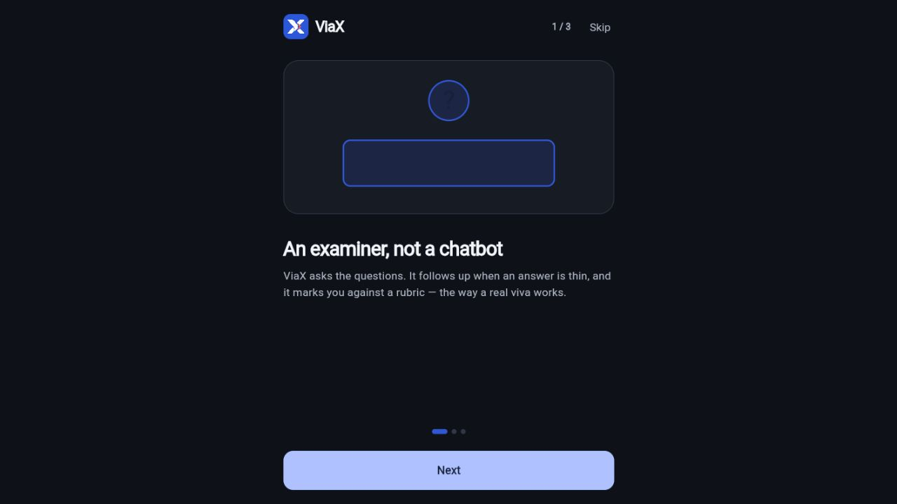
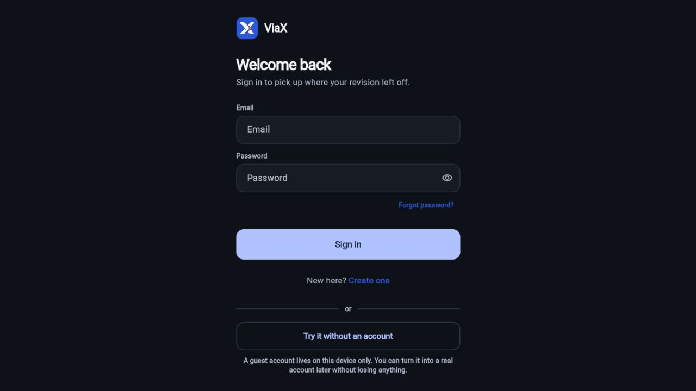

# ViaX


An open-source study companion for learning from your notes, practicing viva questions, and chatting with AI.

[Open the app](https://viax-iota.vercel.app) · [Download the presentation](docs/presentation/ViaX-Overview.pptx) · [Read the slides](docs/presentation/ViaX-Overview.pdf) · [Contribute](CONTRIBUTING.md)

## A look inside

### A dedicated space for AI conversations

Ask general questions or select a subject to bring your study notes into the conversation.



<details>
<summary>Mobile view and getting started</summary>

<p align="center"></p>





</details>

These are actual app captures. Chat screens show the empty conversation state in light mode; onboarding and sign-in show dark mode. The cover uses AI-generated study artwork. See the [visual asset notes](docs/media/README.md).

## The study workflow

| Step | What happens |
| --- | --- |
| Add your notes | Save your material under a subject. |
| Build a study base | Extract passages, embeddings, and concepts supported by the notes. |
| Practice | Use viva questions, flashcards, quizzes, or matching exercises. |
| Return to weak areas | Follow mastery and revision information as you study. |

## Features

- Upload PDF, DOCX, PPTX, Markdown, CSV, or text notes.
- Extract concepts with supporting passages from your documents.
- Practice viva questions and track revision and mastery.
- Study with flashcards, quizzes, and matching exercises.
- Chat about general topics or use a subject's study notes for context.
- Retry saved documents when processing fails.

AI answers can be incorrect. General chat does not browse the web; note-grounded answers depend on the material you upload. Document text is sent to your configured AI provider for processing.

## Project layout

| Directory | Purpose |
| --- | --- |
| `mobile/` | Flutter application, including the web client |
| `supabase/` | Database migrations and deployed Edge Functions |
| `backend/` | Additional Python/FastAPI service and domain logic |
| `launch-video/` | Remotion launch-video source |
| `docs/` | Architecture decisions and implementation notes |

The deployed Flutter app uses Supabase authentication, storage, database APIs, and Edge Functions. Running the separate Python service is not required for that path.

## Run your own instance

Prerequisites: Flutter with Dart, Supabase CLI, and a Supabase project. Local Supabase also requires Docker. Node.js is needed only for the launch video and optional deployment tooling.

1. Clone this repository and create your own Supabase project.
2. Link and apply the database migrations:

   ```sh
   supabase login
   supabase link --project-ref YOUR_PROJECT_REF
   supabase db push
   ```

3. In your Supabase project's Edge Function secrets, set:

   ```text
   NVIDIA_API_KEY=your-private-provider-key
   NVIDIA_CHAT_MODELS=nvidia/nemotron-3.5-lightning-30b-a3b
   NVIDIA_EMBED_MODEL=nvidia/llama-nemotron-embed-vl-1b-v2
   ```

   The embedding requests use 1024 dimensions to match the database. Both document ingestion and question retrieval must use the same model. OpenRouter is an optional fallback; it is not required for the NVIDIA configuration. Provider model availability can change.

4. Deploy the functions (caller authentication is enforced in the function code):

   ```sh
   supabase functions deploy ingest --no-verify-jwt
   supabase functions deploy examine --no-verify-jwt
   supabase functions deploy chat --no-verify-jwt
   ```

5. Configure Supabase Auth's site URL and redirect allowlist for your app. Enable anonymous sign-in if you want guest access.
6. Start Flutter using your own public project configuration:

   ```sh
   cd mobile
   flutter pub get
   flutter run -d chrome --dart-define=SUPABASE_URL=https://YOUR_PROJECT_REF.supabase.co --dart-define=SUPABASE_KEY=YOUR_PUBLISHABLE_KEY
   ```

The checked-in client defaults point to the hosted demo. Supply both values above to work against your own instance. Publishable keys are public client configuration; service-role keys and provider credentials must remain server-side.

## Build for web

```sh
cd mobile
flutter build web --release --no-web-resources-cdn --no-wasm-dry-run --dart-define=SUPABASE_URL=https://YOUR_PROJECT_REF.supabase.co --dart-define=SUPABASE_KEY=YOUR_PUBLISHABLE_KEY
```

Publish `mobile/build/web` to your static host. Deploying the frontend does not deploy Supabase functions or migrations. See [deployment notes](docs/vercel-deployment.md).

## Optional components

For the Python service, see `backend/pyproject.toml` and `.env.example`. Its provider configuration is separate from the Supabase Edge Functions.

For the launch video:

```sh
cd launch-video
npm ci
npm run dev
```

## Contributing and license

See [CONTRIBUTING.md](CONTRIBUTING.md). Project source is available under the [MIT license](LICENSE). Third-party packages and services retain their own licenses and terms.
